<p align="center">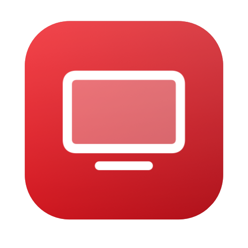</p>

<h1 align="center">TCL Remote for Mac</h1>

<p align="center">
A native remote for TCL TVs: a macOS menu bar app, plus an iPhone and iPad app.<br>
It finds your TV on the local network, pairs once, remembers it, and reconnects on its own,<br>
so your keyboard and trackpad become the remote.
</p>

<p align="center">
<a href="https://github.com/ihusnainalii/tcl-tv-remote/actions/workflows/ci.yml"></a>


<a href="LICENSE"></a>
<a href="CONTRIBUTING.md"></a>
</p>

<p align="center">
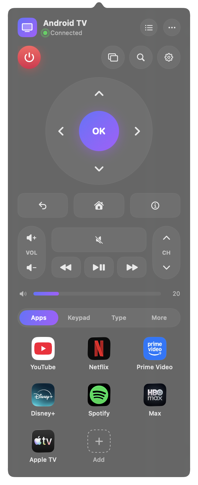
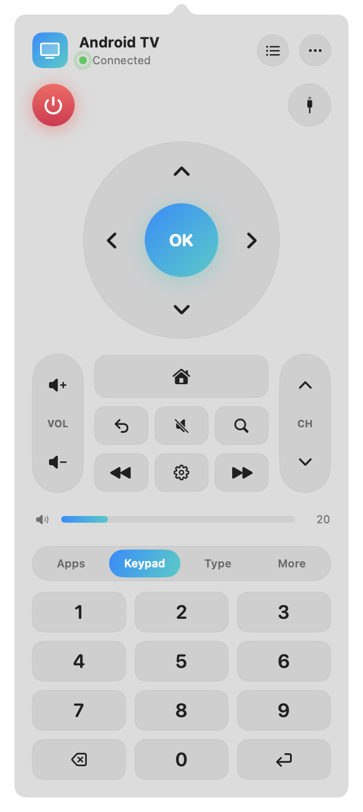
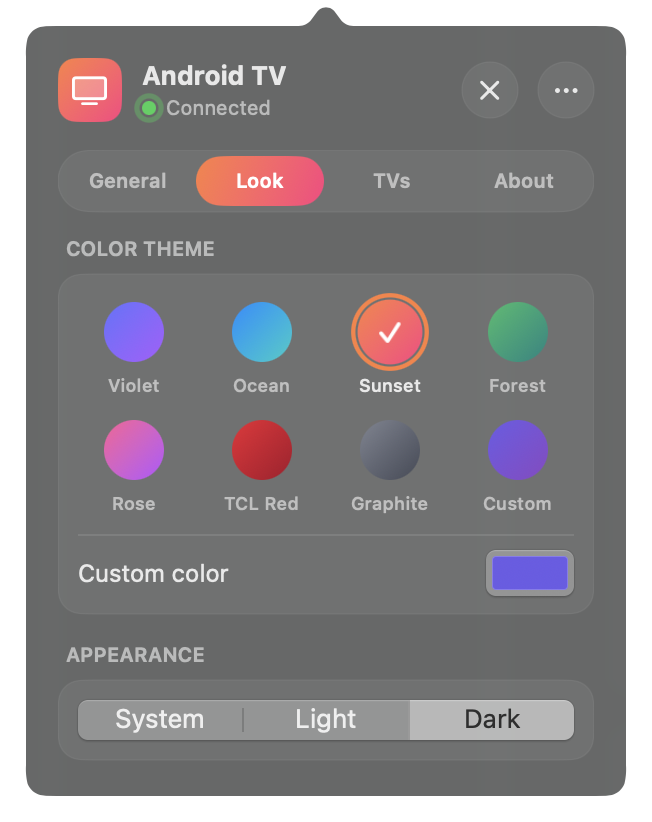
</p>

## Contents
- [Supported TVs](#supported-tvs)
- [iPhone and iPad](#iphone-and-ipad)
- [Features](#features)
- [Screenshots](#screenshots)
- [Install](#install)
- [First run](#first-run)
- [Keyboard shortcuts](#keyboard-shortcuts)
- [Troubleshooting](#troubleshooting)
- [Privacy and security](#privacy-and-security)
- [How it works](#how-it-works)
- [Architecture](#architecture)
- [Development](#development)
- [Releases](#releases)
- [Roadmap](#roadmap)
- [Contributing](#contributing)
- [Disclaimer](#disclaimer)
- [License](#license)

## Supported TVs

| TCL TV | Protocol | Pairing |
|---|---|---|
| **Google TV** and **Android TV** | Android TV Remote v2 (TLS, ports 6466/6467) | One-time 6-character code shown on the TV |
| **Roku TV** | Roku External Control Protocol (HTTP, port 8060) | None |

Fire TV editions aren't supported yet (see the [Roadmap](#roadmap)). Tested on a TCL Google TV. If you've tried another model, please [let us know](https://github.com/ihusnainalii/tcl-tv-remote/issues/new/choose).

## iPhone and iPad

A native iPhone and iPad app shares every rule, protocol driver and component with the Mac app, with a layout designed for touch.

<p align="center">
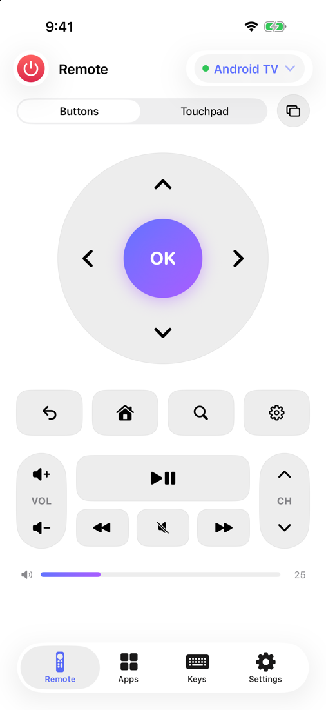
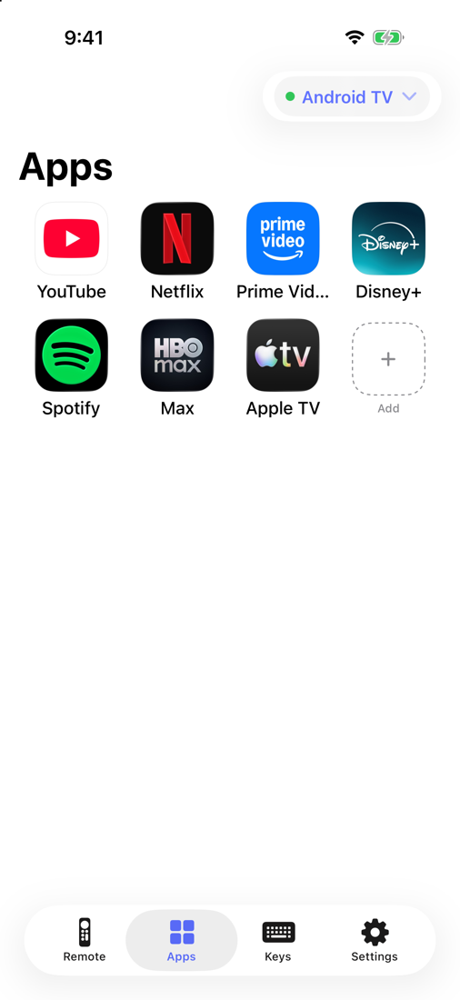
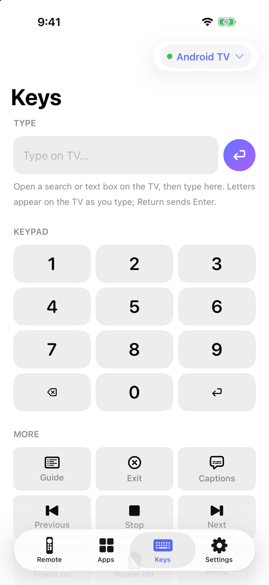
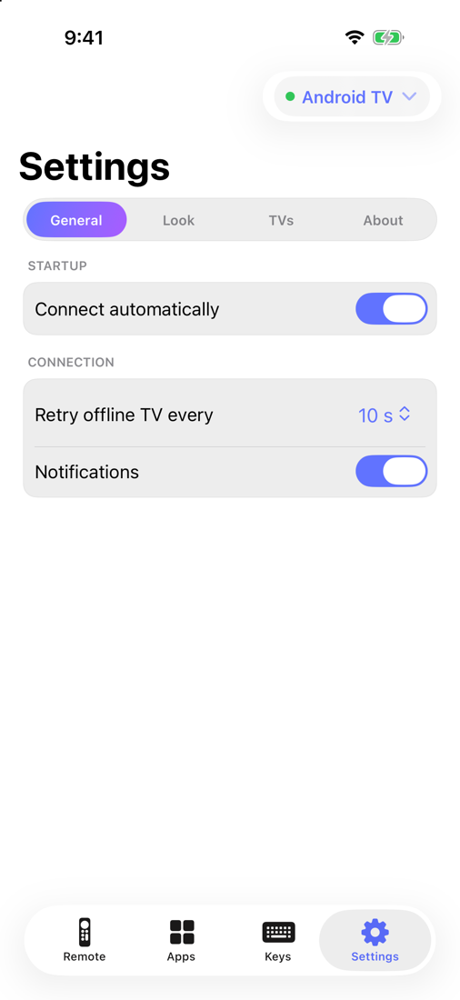
</p>

<p align="center">
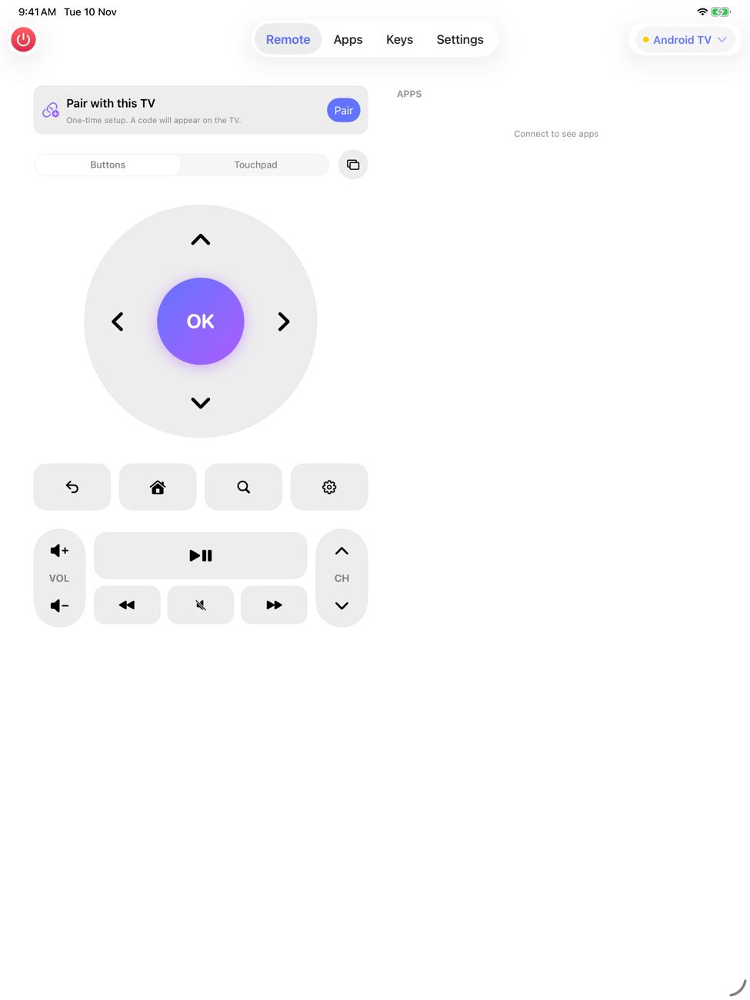
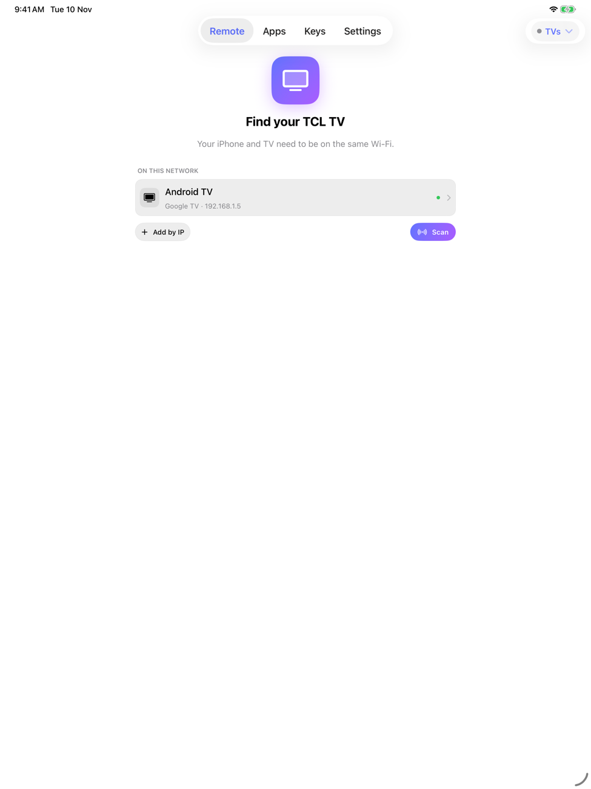
</p>

- **Tab bar** with Remote, Apps, Keys and Settings. iPhone shows it at the bottom; iPadOS shows it at the top.
- **Remote tab:** a large arrow pad, or a **touchpad**: swipe to move (each swipe step is one arrow press, with haptics) and tap to select. Big buttons for back, home, search, settings, play/pause and media, plus volume and channel rockers and the live volume bar.
- **TV switcher** in the navigation bar: switch between saved TVs or find new ones. Pairing opens as a sheet.
- **iPad:** a two-column remote, with controls on the left and your apps on the right.
- **Keys tab:** a live keyboard for the TV's text boxes, a number pad, and extra keys (guide, captions, stop, power on/off).
- With a hardware keyboard attached, the same shortcuts as on the Mac work, and Settings lists them.

### Build and run

```bash
brew install xcodegen
cd iOS && xcodegen        # generates TCLRemoteiOS.xcodeproj from project.yml
open TCLRemoteiOS.xcodeproj
```

Run the `TCLRemoteiOS` scheme on a simulator. To run on a device, set your team in Xcode. A free Personal Team works, but its builds expire after 7 days.

**Differences from the Mac app:**
- No launch at login, quit or update check. iOS apps update through the App Store.
- The pairing certificate is created natively (a self-signed X.509 certificate built in Swift) and kept in the iOS Keychain.
- Discovering Roku TVs on a real iPhone needs Apple's multicast networking entitlement. Until that's granted, use **Add by IP** for Roku. Google TV discovery works without it.

## Features

### Find and connect
- Finds TVs automatically (Bonjour for Google/Android TV, SSDP for Roku), or add one by IP address
- Remembers every TV with a "last used" time, and lets you favorite and rename TVs
- Connects on launch to your favorite TV, or the last one you used
- Reconnects on its own when the Mac rejoins Wi-Fi, wakes from sleep, or the TV restarts, and finds the TV again if its IP address changes

### Remote
- Power (toggle, on, off), arrow pad with OK, back, home, menu, settings, info, guide, exit, search and captions
- Volume and channel buttons with hold-to-repeat
- **Live volume bar** (Google TV): shows the TV's real level; drag it or swipe two fingers on the trackpad
- Play/pause, stop, rewind, fast-forward, previous and next
- HDMI 1–4, AV and Live TV inputs, plus a 0–9 keypad
- **Type** tab: a live keyboard for the TV's search and text boxes, with Return sending Enter

### Apps
- App launcher with real app icons
- Roku lists every installed app. Google TV can't report its installed apps, so you add yours from a searchable picker of popular TV apps, or with a custom link
- Favorite apps stay first, followed by your recent apps

### Mac integration
- Menu bar panel attached to its icon, resizing smoothly to fit its content
- Full keyboard control while the panel is open
- Settings inside the panel: launch at login, auto-connect, retry interval, notifications, saved TVs, reset pairing, check for updates
- 7 color themes or any custom color, plus System, Light or Dark mode
- macOS notifications when a TV disconnects, reconnects or needs pairing
- Reduce Motion support and VoiceOver labels on every control

## Screenshots

**Mac menu bar**

| Remote and apps | More controls | Light mode, Ocean theme |
|---|---|---|
|  | 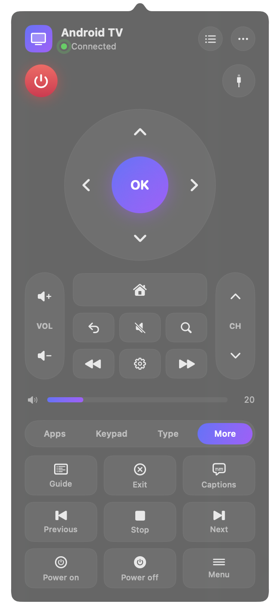 |  |

| Settings | Color themes |
|---|---|
| 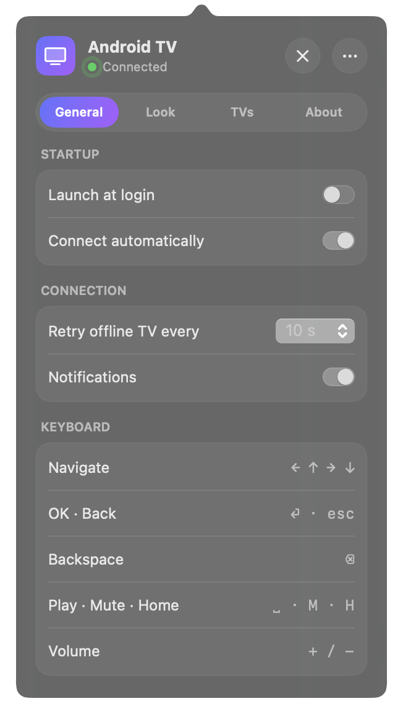 |  |

**iPhone and iPad:** see [iPhone and iPad](#iphone-and-ipad).

Regenerate the Mac screenshots with `scripts/screenshots.sh` (needs a built app and a reachable TV). The iOS screenshots come from the Simulator (`xcrun simctl io <device> screenshot`).

## Install

### Download
Get the latest `.dmg` from [Releases](https://github.com/ihusnainalii/tcl-tv-remote/releases), open it, and drag **TCL Remote** into Applications. It runs natively on Apple Silicon and Intel Macs.

Releases built without an Apple Developer ID aren't notarized, so macOS blocks the first launch. Right-click the app, choose **Open**, and confirm.

### Build from source
Requires macOS 15 or later and Xcode 16 or later.

```bash
git clone https://github.com/ihusnainalii/tcl-tv-remote.git
cd tcl-tv-remote
scripts/build.sh
open "build/TCL Remote.app"
```

You can also open `Package.swift` in Xcode and run the `TCLRemote` scheme.

## First run

1. Allow **Local Network** access when macOS asks. Without it the app can't see your TV.
2. Click the remote icon in the menu bar. The app scans your network.
3. Pick your TV.
   - **Google TV / Android TV:** click **Pair**, then type the code shown on the TV.
   - **Roku TV:** it connects right away. If keys don't work, set the TV's *Settings → System → Advanced system settings → Control by mobile apps* to **Default** or **Permissive**.
4. From then on, the app connects by itself.

macOS may ask once whether TCL Remote can use the **"TCL Remote pairing certificate"** item in your Keychain. Choose **Always Allow**.

## Keyboard shortcuts

These work while the panel is open.

| Key | Action |
|---|---|
| ← ↑ → ↓ | Navigate |
| Return | OK |
| Esc | Back |
| Delete | Backspace |
| Space | Play / Pause |
| `+` / `−` | Volume up / down |
| `M` | Mute |
| `H` | Home |
| ⌘ , | Open Settings |

## Troubleshooting

| Problem | Fix |
|---|---|
| No TVs found | Check the Mac and TV are on the same network, and that *System Settings → Privacy & Security → Local Network* allows TCL Remote. Guest Wi-Fi often blocks device discovery; use **Add by IP**. |
| "TV is unreachable" | The TV must be on or in network standby. Turn on its option to stay connected to the network while off (often under *Settings → System → Power*). |
| Google TV asks to pair again | Use **Re-pair** in the panel, or **Settings → TVs → Reset Pairing** to start fresh. |
| Typing does nothing | Open a search or text box on the TV first. On Google TV, letters arrive in lowercase. |
| Volume slider is missing | It appears only on Google TV, which reports its volume. Roku doesn't. |
| Roku ignores keys | Set *Control by mobile apps* to Default or Permissive (see [First run](#first-run)). |
| Keychain asks again and again | Each local build has a new signature. Choose **Always Allow**; signed releases ask only once. |

## Privacy and security

- Everything happens on your local network. There's no account, no server and no analytics.
- The Google TV pairing certificate is generated on your Mac and stored in the macOS Keychain.
- Saved TVs and preferences stay in the app's local preferences.
- Requests leave your network only for app icons from Apple's public App Store lookup API (sending just the app name) and for **Check for Updates** (GitHub's releases API).
- Google TV traffic is TLS-encrypted. Roku's control protocol is plain HTTP by design.

To report a vulnerability privately, see [SECURITY.md](SECURITY.md).

## How it works

**Google TV / Android TV.** The app speaks the Android TV Remote v2 protocol:
- **Pairing (port 6467):** the app connects over TLS with its own client certificate and exchanges protobuf messages. The TV then shows a code, and the app proves it saw the code by sending SHA-256 of both certificates' RSA keys plus the code.
- **Remote (port 6466):** the TV accepts that certificate from then on. The app sends key presses and app links, and the TV pushes back power state, volume level and keep-alive pings.

**Roku TV.** Plain HTTP requests to the TV's External Control Protocol:
- `POST /keypress/<Key>` sends a key, and `POST /keypress/Lit_<char>` types a character
- `/query/apps` lists apps, `/query/icon/<id>` returns each app's icon, and `POST /launch/<id>` opens one

**Discovery.** The app looks for Google TVs advertising the Bonjour service `_androidtvremote2._tcp`, and sends an SSDP `M-SEARCH` for `roku:ecp` to find Rokus.

## Architecture

The code is split into layers, and dependencies only point one way: the app shells depend on `RemoteUI`, `RemoteUI` depends on `TVKit`, and `TVKit` depends on nothing but Apple frameworks. TVKit and RemoteUI build for macOS, iOS and iPadOS.

```
Sources/
  TVKit/                       core library: no UI, ~97% test coverage
    Domain/                    TV, KnownTV, TVApp, Key, TVError,
                               TVRemote + capabilities (PairingCapable, StateReporting), RemoteFactory
    Library/TVLibrary          rules for saved TVs and apps (favorites, renames, recents, ordering, IP moves)
    Control/VolumeStepper      reaches a volume level in single steps
    Persistence/TVRepository   storage interface + UserDefaults implementation
    AndroidTV/  Roku/          protocol drivers (the only platform-specific code)
    Discovery/  Apps/  Updates/
  RemoteUI/                    shared SwiftUI UI for macOS, iOS and iPadOS
    State/AppStore             presentation state; coordinates TVKit and system services
    Services/                  connectivity monitor, notifications, login item, preferences, platform shims
    Presentation/Components    shared parts: arrow pad, rockers, keys, keypad, typing, volume bar, themes
    Presentation/Screens       Mac panel screens (remote, TVs, pairing, settings, apps)
    Presentation/Mobile        iPhone/iPad layout: tab bar, touchpad, two-column iPad remote
    Resources/ + Generated/    Localizable.strings and SwiftGen's L10n
  TCLRemote/App/               Mac menu bar shell: status item + popover
iOS/                           iPhone/iPad shell (XcodeGen project.yml + App/)
Tests/TVKitTests/              unit tests, fake TVs on localhost, opt-in live-TV test
```

- The app talks to TVs only through `TVRemote` and the capability protocols. `RemoteFactory` is the only place that knows the concrete drivers.
- Rules live in `TVLibrary`, a value type with no I/O. `AppStore` applies them and saves through `TVRepository`.
- Adding a TV platform means one new driver in TVKit and one line in `RemoteFactory`.

## Development

```bash
brew install swiftlint swiftgen                         # tools used by CI
swiftlint                                               # lint (CI runs it with --strict)
swiftgen                                                # regenerate L10n after editing Localizable.strings
swift test                                              # all tests (uses fake TVs on localhost)
TV_HOST=192.168.1.20 swift test --filter LiveTVTests    # also test a real Google TV
```

- The tests include a **fake Google TV**: a local TLS server speaking Remote v2, used to test pairing, the handshake, keys, typing, app launches, state updates, disconnects and timeouts. Other tests use stubbed HTTP for Roku and the App Store, a local SSDP responder, a test-only Bonjour service, and a test-only Keychain item, so they never touch your real pairing.
- The live test pairs if needed (write the code shown on the TV to the file named by `TV_CODE_FILE`), connects, reads the power and volume state, and presses volume up then down.
- Launch options: `--open` opens the panel at launch, `--settings` opens it on Settings, and `--devices` opens it on the TV list.
- `swift scripts/make-icon.swift` regenerates the app icon; `scripts/screenshots.sh` regenerates the screenshots.

## Releases

- `scripts/build.sh` builds a universal app. `VERSION=1.2.0` stamps the version; `SIGN_IDENTITY="Developer ID Application: …"` signs it with the hardened runtime (otherwise ad-hoc).
- `scripts/make-dmg.sh` packages `build/TCLRemote-<version>.dmg`. `NOTARY_PROFILE` (from `xcrun notarytool store-credentials`) notarizes and staples it.
- **CI** ([`ci.yml`](.github/workflows/ci.yml)) runs on every pull request and every push to `main`, in stages. Each stage is a required check, so a PR can only merge once all of them pass:
  1. **Lint**: SwiftLint in strict mode, plus a check that SwiftGen's generated code is up to date
  2. **Build**: compiles the package and tests
  3. **Tests**: runs every test, marks each failure on the PR, and writes a results summary
  4. **Coverage**: fails if TVKit line coverage drops below **90%**, with a per-file summary
  5. **App bundle**: builds the universal Mac app and attaches it to the run
  6. **iOS app**: generates the Xcode project and builds the iPhone/iPad app
- **Releases:** pushing a tag such as `v1.1.0` runs [`release.yml`](.github/workflows/release.yml), which builds the DMG and publishes a GitHub release. It signs and notarizes when these repository secrets exist: `MACOS_CERT_P12` (base64 Developer ID `.p12`), `MACOS_CERT_PASSWORD`, `APPLE_ID`, `APPLE_TEAM_ID`, `APPLE_APP_PASSWORD`.

## Roadmap

Ideas under consideration. Contributions welcome.

- **Real text input with upper and lower case** on Google TV, by syncing with the TV's on-screen keyboard
- **Show the app currently on screen** (Google TV)
- **Voice search** through the TV's Assistant, using the Mac's microphone
- **Wake-on-LAN** for TVs that switch off their network in standby
- **Fire TV support**
- **Optional ADB mode** for power users, which would allow the installed-app list, now-playing info and a mouse pointer on Google TV

## Contributing

This project is **open to contributions**: bug reports, ideas, docs and code are all welcome. Start with [CONTRIBUTING.md](CONTRIBUTING.md), and please follow the [Code of Conduct](CODE_OF_CONDUCT.md). Changes are listed in [CHANGELOG.md](CHANGELOG.md).

### Help wanted
- **Testing on real TVs:** tell us your TCL model and whether pairing, keys, volume and apps work.
- **Items from the [Roadmap](#roadmap)**, especially Fire TV and real text input.
- **More app links** for the Google TV picker (`AppCatalog`).
- **Translations:** all UI text is in `Sources/TCLRemote/Resources/en.lproj/Localizable.strings`. Add a `<language>.lproj` copy to translate the app.
- **Accessibility** improvements.

Look for issues labelled [`good first issue`](https://github.com/ihusnainalii/tcl-tv-remote/labels/good%20first%20issue) or [`help wanted`](https://github.com/ihusnainalii/tcl-tv-remote/labels/help%20wanted). CI requires 90% TVKit coverage and no failing tests, so new code needs tests.

If you find the app useful, starring the repo helps other TCL owners find it.

## Disclaimer

This is an independent open-source project. It isn't affiliated with, endorsed by or sponsored by TCL, Google, Roku, Amazon, Apple or any app shown in the launcher. All product names, logos and brands are the property of their respective owners and are used only to identify compatible devices and apps. App icons are fetched at runtime from the TV or Apple's public lookup API and aren't distributed with this project; screenshots show them for illustration only.

## License

[Apache License 2.0](LICENSE)
